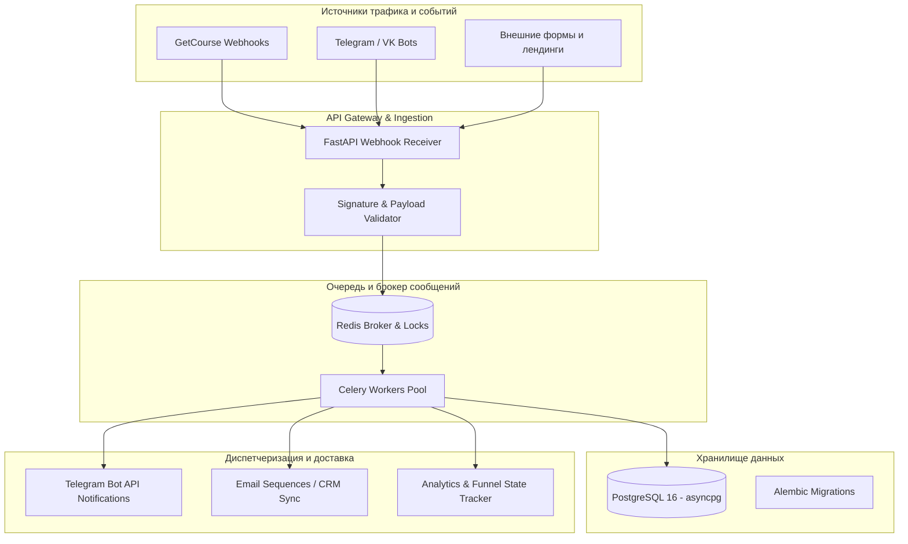

# 🚀 FunnelHub — High-Performance Automation Hub & Lead Communication Gateway

[](https://www.python.org/)
[](https://fastapi.tiangolo.com/)
[](https://www.postgresql.org/)
[](https://redis.io/)
[](https://www.docker.com/)

**FunnelHub** — серверная шина интеграций, база лидов и отказоустойчивый коммуникационный шлюз вокруг EdTech платформ (GetCourse, Telegram, VK, внешние CRM). Система спроектирована для работы под пиковыми нагрузками (вебинарные наплывы до 500+ вебхуков/сек), гарантируя нулевую потерю событий, транзакционную дедупликацию и мгновенную доставку нотификаций.

---

## 🏗️ Архитектура системы



---

## ⚡ Ключевые возможности

1. **Отказоустойчивый прием вебхуков:**
   * Асинхронные endpoints на FastAPI с валидацией схем через Pydantic.
   * Немедленный `200 OK` источнику с фоновой отправкой задачи в очередь Celery (устранение таймаутов GetCourse при нагрузке).
2. **Идемпотентность и защита от дублей:**
   * Распределенные блокировки в Redis по уникальным хэшам событий `(user_id + action_id + timestamp)`.
   * Исключение повторных начислений, дублей писем и сообщений в мессенджеры.
3. **Транзакционное хранилище:**
   * SQLAlchemy 2.0 Async + asyncpg.
   * Полное версионирование схемы БД через миграции Alembic.
4. **Оркестрация и мониторинг:**
   * Docker Compose для мгновенного локального развертывания и продакшн-окружения на Linux VPS.
   * Health checks (`/health`), структурированное JSON-логирование.

---

## 📂 Структура проекта

```text
FunnelHub/
├── src/
│   ├── api/             # Маршруты FastAPI (webhooks, health, leads)
│   ├── core/            # Конфигурация Pydantic, безопасность, logging
│   ├── database/        # Сессии SQLAlchemy, модели PostgreSQL
│   ├── services/        # Бизнес-логика обработки лидов и синхронизации
│   └── workers/         # Фоновые задачи Celery и коннекторы
├── migrations/          # Миграции схемы Alembic
├── docker-compose.yml   # Запуск связки App + PostgreSQL + Redis
├── Dockerfile           # Оптимизированный мультистейдж образ
├── pyproject.toml       # Зависимости и управление пакетами через uv
└── README.md            # Документация системы
```

---

## 🚀 Быстрый старт

### 1. Клонирование и настройка переменных
```bash
git clone https://github.com/circlealgorythm/FunnelHub.git
cd FunnelHub
cp .env.example .env
```

### 2. Запуск через Docker Compose
```bash
docker compose up -d --build
```

### 3. Проверка работоспособности
```bash
curl http://localhost:8000/health
```

### 4. Запуск тестов и линтеров
```bash
ruff check .
pytest -v
```
